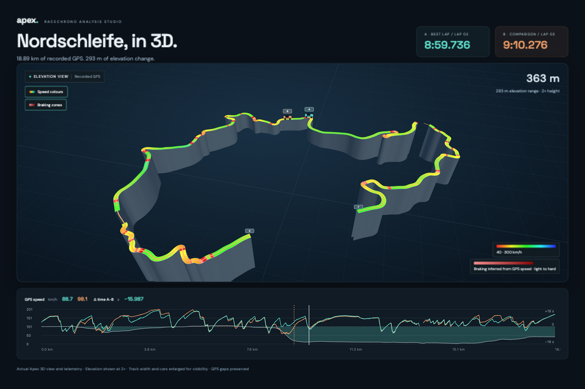

# Apex · RaceChrono analysis studio

Compare laps. Find where you gain time. Review your onboard video beside the data.

[**Open Apex**](https://apex.mthracelab.com/)



## Start here

1. Import a RaceChrono `.rcz` session or a Dragy `.vbo` file.
2. Select the laps you want to compare. Follow the charts and the 2D or 3D map.
3. Add your local onboard video. Set its time offset to align it with the session.

If a VBO imports with no timed laps, Analyze shows its recorded path and **Set start/finish line**. Place the line on the map, preview the detected laps, then choose **Use this line** to open the charts and playback controls. If several recordings need setup, select which one to time.

Save a project archive to keep your analysis. Session data stays in your browser by default. Optional Google Drive sync uploads the selected archive. Video files stay local.

GPS elevation and speed-based braking values are estimates. The 3D view does not show a surveyed road surface. Video playback depends on your browser's codec support.

## Run locally

Use Node.js and npm.

```sh
npm ci
npm run dev -- --port 5174
```

See the [technical guide](TECHNICAL_GUIDE.md) for file formats, video sync, backups, optional Drive sync, and development checks.
