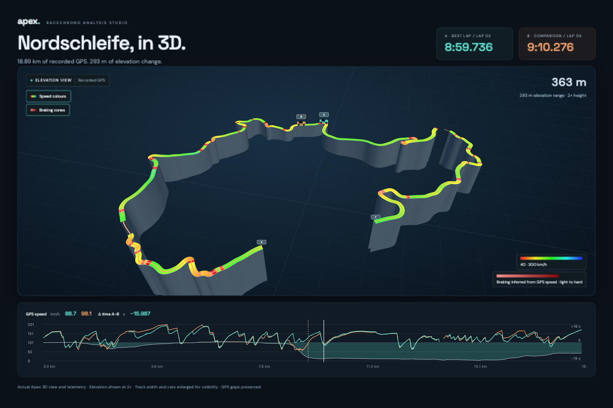

# Apex · RaceChrono analysis studio

Compare laps. Find where you gain time. Review your onboard video beside the data.

[**Open Apex**](https://apex.mthracelab.com/)



## Start here

1. Import a RaceChrono `.rcz` session or a Dragy `.vbo` file.
2. Select the laps you want to compare. Follow the charts and the 2D or 3D map.
3. Add your local onboard video. Set its time offset to align it with the session.

If a VBO imports with no timed laps, the timing setup opens automatically. Zoom in and tap the recorded path at the start/finish location. Check the direction arrow and preview the detected laps, then choose **Use this line** to open the charts and playback controls. Cancel keeps the recording available for setup later through **Set start/finish line** on Analyze.

On a phone or tablet, open **Tracks & sessions** to switch circuits or tick individual sessions for comparison. The analyzer uses the full screen width, with lap totals, chart units, playback readouts and export controls available on small screens.

Open **Race Engineer** to compare each section’s three quickest valid passes on a track map, with speed and longitudinal/lateral G traces. Connect your local MCP agent, copy a corner or whole-session review request into its chat, and let it return evidence-linked advice directly to Apex. No LLM API credentials are entered in Apex. See the [connection guide](docs/local-mcp.md) and [Race Engineer guide](docs/race-engineer.md).

Save a project archive to keep your analysis. Session data stays in your browser by default. Optional Google Drive sync uploads the selected archive. Video files stay local.

GPS elevation and speed-based braking values are estimates. The 3D view does not show a surveyed road surface. Video playback depends on your browser's codec support.

## Run locally

Use Node.js and npm.

```sh
npm ci
npm run dev -- --port 5174
```

See the [technical guide](TECHNICAL_GUIDE.md) for file formats, video sync, backups, optional Drive sync, and development checks.

## Local agent connection

Connect a local MCP agent to inspect the current workspace, query telemetry, navigate comparisons and request synchronized video stills. Follow the [three-step connection guide](docs/local-mcp.md#connect-in-three-steps). The header pill is orange while waiting and green when your agent is connected. The website remains static; the MCP helper runs locally.

Analyze labels detected GPS bends **T1, T2, …** on the 2D/3D map. Select a turn to focus its telemetry; the same IDs and distance ranges are available to the MCP agent. Numbering is automatic and may differ from the circuit’s official turns.

Connected bends can receive separate numbers when two sustained tightening points are separated by a clear relaxation, even without a straight between them. Brief GPS spikes and shallow shoulders do not create additional turns.
